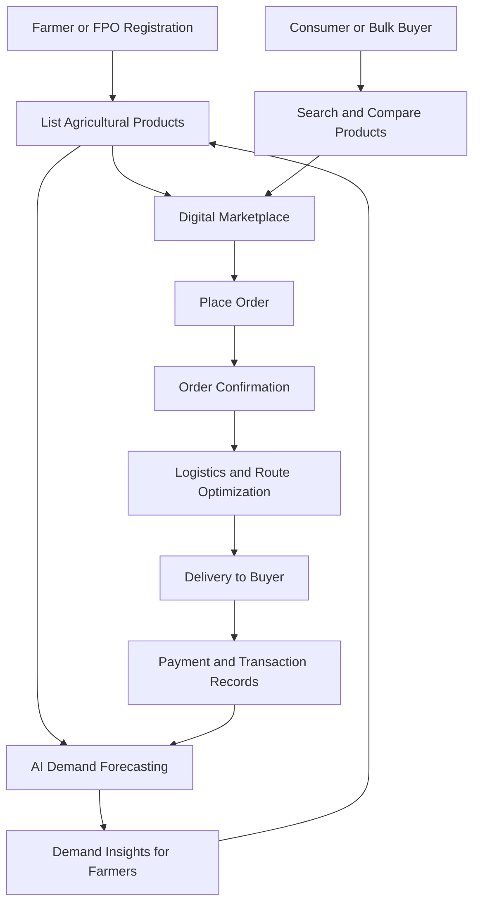

# Smart India Hackathon Workshop

**Date:** 26 October 2026  
**Reference Number:** 26009952  
**Name:** Syed Abdul Razzaq S

---

## Problem Title
**SIH 26033: Multiple Intermediaries Reduce Farmers' Earnings and Increase Consumer Prices**

## Problem Creator's Organization
Ministry of Consumer Affairs, Food & Public Distribution

## Theme
Agriculture, FoodTech & Rural Development

## Problem Description
Farmers often depend on multiple intermediaries to sell their agricultural products. These intermediaries reduce farmers' profits and increase prices for consumers. Poor logistics, lack of market information, and inaccurate demand estimation also contribute to food wastage and supply chain inefficiencies.

The proposed solution is an AI-powered digital marketplace that directly connects farmers and Farmer Producer Organizations (FPOs) with consumers and bulk buyers.

---

# Proposed Solution

## 1. Detailed Explanation of the Proposed Solution

We propose **AgriConnect – An AI-Powered Direct Agricultural Marketplace**.

AgriConnect is a digital platform that enables farmers to sell their products directly to consumers, retailers, wholesalers, hotels, restaurants, and other bulk buyers.

### Key Features

- **Direct Marketplace:** Connect farmers directly with buyers.
- **AI Demand Forecasting:** Predict demand using historical sales and seasonal trends.
- **Transparent Pricing:** Display product prices and available quantities.
- **Smart Logistics:** Optimize delivery routes and coordinate transportation.
- **Digital Payments:** Support secure online payment integration.
- **Order Tracking:** Allow users to track order status.
- **Multilingual Support:** Provide regional-language options for farmers.
- **FPO Support:** Enable groups of farmers to combine produce and fulfill bulk orders.

## 2. How It Addresses the Problem

| Problem | Solution |
|---|---|
| Multiple intermediaries | Direct farmer-to-buyer transactions |
| Low farmer earnings | Better market access and price transparency |
| High consumer prices | Reduced avoidable supply-chain costs |
| Uncertain demand | AI-based demand forecasting |
| High transportation costs | Route optimization and grouped deliveries |
| Food wastage | Faster buyer matching and better demand planning |
| Limited market access | Online marketplace accessible through mobile devices |

## 3. Innovation and Uniqueness

- AI-powered demand prediction for agricultural products.
- Smart matching of farmers with suitable buyers.
- Digital price comparison for informed selling decisions.
- Optimized delivery routes to reduce unnecessary travel.
- Collective selling through Farmer Producer Organizations.
- Digital transaction records to improve transparency.
- A simple, mobile-friendly interface with regional-language support.

---

# Technical Approach

## 1. Technologies to Be Used

| Component | Technology |
|---|---|
| Frontend | HTML, CSS, JavaScript, React.js |
| Backend | Python with FastAPI |
| Database | PostgreSQL |
| Machine Learning | Python, Pandas, NumPy, Scikit-learn |
| Demand Forecasting | Time-series analysis and regression models |
| Maps | OpenStreetMap |
| Route Optimization | OSRM or a suitable routing service |
| Version Control | Git and GitHub |
| Deployment | Cloud hosting or an application server |

These technologies are proposed for the implementation and may be adjusted according to project requirements.

## 2. Methodology and Implementation

### Phase 1: Requirement Analysis
- Identify the needs of farmers, buyers, and logistics providers.
- Define the functional requirements.
- Study existing agricultural supply-chain challenges.

### Phase 2: UI/UX Design
- Design a simple and responsive website.
- Create separate dashboards for farmers and buyers.
- Add regional-language support.

### Phase 3: Backend and Database
- Create user, product, order, and delivery records.
- Develop APIs for registration and product management.
- Implement authentication and access controls.

### Phase 4: Marketplace Development
- Allow farmers to list products, quantities, prices, and images.
- Allow buyers to search, compare, and order products.
- Add order confirmation and tracking.

### Phase 5: AI Integration
- Collect relevant historical sales and market data.
- Develop a demand forecasting model.
- Generate demand estimates and recommendations.
- Evaluate and improve forecast accuracy.

### Phase 6: Logistics Optimization
- Identify pickup and delivery locations.
- Group compatible orders where practical.
- Calculate efficient delivery routes.
- Track delivery progress.

### Phase 7: Testing and Deployment
- Test all major platform features.
- Conduct security and usability testing.
- Deploy an MVP (Minimum Viable Product).
- Collect user feedback and improve the platform.

## 3. System Workflow

## 4. Main System Modules

1. **User Management:** Registration, login, and profile management.
2. **Product Management:** Product listings, prices, quantities, and availability.
3. **Search Module:** Search by product, price, location, and quantity.
4. **Order Management:** Ordering, confirmation, and order tracking.
5. **AI Module:** Demand prediction and market insights.
6. **Logistics Module:** Delivery coordination and route optimization.
7. **Payment Module:** Payment status and transaction history.
8. **Admin Module:** User verification, issue management, and monitoring.

---

# Feasibility and Viability

## 1. Feasibility Analysis

### Technical Feasibility
- Uses established web development technologies.
- Open-source tools reduce initial development costs.
- AI models can be developed using existing machine learning libraries.
- Mapping services can support delivery planning.

### Economic Feasibility
- The initial version can be developed using open-source software.
- Development can begin with essential marketplace features.
- Partnerships with FPOs and logistics providers can support adoption.
- Optional service fees or institutional subscriptions may support long-term operations.

### Operational Feasibility
- Farmers can register individually or through FPOs.
- Buyers can place orders using a website or mobile device.
- Existing transport providers can support deliveries.
- Training and regional-language interfaces can help users adopt the system.

## 2. Potential Challenges and Risks

- Limited digital literacy among some farmers.
- Poor internet connectivity in rural areas.
- Insufficient historical data for accurate AI predictions.
- Product quality differences and disputes.
- Transportation, storage, and delivery challenges.
- Payment security and user trust.
- Data privacy and cybersecurity risks.

## 3. Strategies for Overcoming Challenges

- Provide a simple, lightweight, mobile-friendly interface.
- Offer regional-language support and assisted registration.
- Start with basic forecasting and improve it as data becomes available.
- Introduce product descriptions, images, and quality information.
- Partner with local logistics providers and collection centers.
- Use secure authentication and encrypted connections.
- Maintain clear payment records and dispute-resolution procedures.
- Pilot the platform with a small group of farmers and buyers before expansion.

---

# Impact and Benefits

## 1. Potential Impact on the Target Audience

### Farmers
- Improved access to buyers.
- Better opportunities to negotiate selling prices.
- Reduced dependence on unnecessary intermediaries.
- Improved demand and sales insights.
- Opportunities to sell collectively through FPOs.

### Consumers
- Potentially lower prices through improved supply-chain efficiency.
- Better access to fresh agricultural products.
- Greater price transparency.
- Convenient ordering and delivery tracking.

### Bulk Buyers
- Easier procurement of agricultural products.
- Better visibility into prices and availability.
- Opportunities to establish direct relationships with farmers.

### Logistics Providers
- Better delivery coordination.
- More efficient route planning.
- Opportunities to group compatible shipments.

## 2. Social, Economic, and Environmental Benefits

| Category | Expected Benefit |
|---|---|
| Economic | Better earning opportunities for farmers |
| Social | Improved market access for rural communities |
| Environmental | Potential reduction in food wastage and unnecessary travel |
| Technological | Greater adoption of digital agriculture |
| Supply Chain | Improved transparency and coordination |
| Rural Development | Stronger connections between farmers and buyers |

## 3. Expected Outcomes and Evaluation

The pilot project will measure:

- Number of registered farmers and buyers.
- Number of completed orders.
- Changes in farmer selling prices and net earnings.
- Buyer satisfaction and repeat purchases.
- Delivery times and fulfillment rates.
- Reported food wastage.
- Accuracy of demand forecasts.
- Logistics efficiency.

Actual results will be evaluated during testing rather than assumed in advance.

---

# Research and References

1. **Ministry of Agriculture & Farmers Welfare, Government of India**  
   https://agriwelfare.gov.in/

2. **e-NAM – National Agriculture Market**  
   https://enam.gov.in/

3. **Ministry of Consumer Affairs, Food & Public Distribution**  
   https://consumeraffairs.nic.in/

4. **Digital India**  
   https://www.digitalindia.gov.in/

5. **React Documentation**  
   https://react.dev/

6. **FastAPI Documentation**  
   https://fastapi.tiangolo.com/

7. **PostgreSQL Documentation**  
   https://www.postgresql.org/docs/

8. **Scikit-learn Documentation**  
   https://scikit-learn.org/stable/

9. **OpenStreetMap**  
   https://www.openstreetmap.org/

10. **Open Source Routing Machine (OSRM)**  
    https://project-osrm.org/

---

# Conclusion

**AgriConnect – An AI-Powered Direct Agricultural Marketplace** aims to improve the agricultural supply chain by connecting farmers and FPOs directly with consumers and bulk buyers.

By combining digital commerce, AI-based demand forecasting, transparent pricing, and logistics optimization, the platform seeks to improve farmers' market access, reduce avoidable costs, and make agricultural products more accessible to consumers.

The project will begin with a minimum viable product containing registration, product listings, search, order management, and basic delivery coordination. AI forecasting and advanced logistics features can be added as reliable data becomes available.

---

**Submitted By:** Syed Abdul Razzaq S  
**Reference Number:** 26009952  
**Problem ID:** SIH 26033
